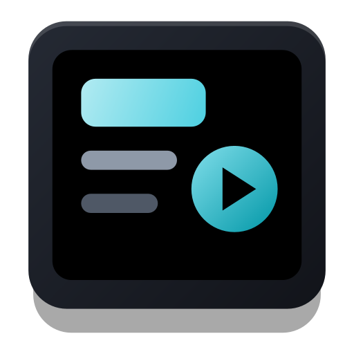

<!--
================================================================================
README UNIVERSAL TEMPLATE SPECIFICATION & APPLIED RULES
================================================================================
-->

<div align="center">



# DroidDeck

[](https://developer.android.com/about/versions/oreo) [](https://developer.android.com/compose) [](https://github.com/mina-android/DroidDeck/releases) [](LICENSE)

<p align="center">
  An Always-On Display (AOD) desk dashboard and control center for Android. Built natively in Kotlin and Jetpack Compose with a strict #000000 pure-black OLED interface, adaptive portrait/landscape layouts, media controls, notification pills, incoming and ongoing call handling, and working-hours lockscreen automation.
</p>

</div>

---

## Navigation

[Features](#features) &bull; [Screenshots](#screenshots) &bull; [Downloads](#downloads) &bull; [Self Building & Local Setup](#self-building--local-setup) &bull; [Frequently Asked Questions](#frequently-asked-questions) &bull; [Contribution](#contribution) &bull; [About the Developer](#about-the-developer) &bull; [Donate](#donate) &bull; [License](#license)

---

## Features

### Core Capabilities

- **Pure `#000000` OLED Adaptive Dashboard**: Switches between a vertical 1-column Portrait layout and a 2-column Landscape grid with cross-column drag-and-drop widget reordering (`CLOCK`, `RECENT_CALLS`, `MUSIC_CONTROLS`, `NOTIFICATIONS`, `QUICK_APPS`) and `1.dp` `#1F1F1F` outlines.
- **Zero-Bridge Media, Volume & Notification Engine**: `DroidDeckNotificationService` binds directly to Android's `NotificationListenerService` and `MediaSessionManager` to render active track metadata, dimmed monochrome artwork, live-extrapolated playback progress with interactive seekbar scrubbing, transport controls, Media Volume slider, and up to 5 dismissible notification pills with app blacklisting and DND-aware hiding.
- **Interactive Incoming & Ongoing Call Controls**: Detects `Notification.CATEGORY_CALL` alerts from cellular dialers and VoIP apps, surfacing pinned Answer/Decline/Mute Ringer and Ongoing Call banners directly above the Clock with live duration, Speakerphone toggle, Mic Mute toggle, and End Call actions via `TelecomManager` and `Notification.CallStyle`.
- **Battery & OLED Burn-In Protection**: Aligns clock updates to exact minute boundaries when seconds are disabled (0 FPS idle rendering), applies deterministic `[-4, +4]` dp pixel shifting every minute, dims screen brightness from `1%` to `100%` with tap-to-brighten, and blanks the display via `Sensor.TYPE_PROXIMITY` when covered.
- **Working Hours & Lockscreen Automation**: `WorkingHoursLockService` monitors `ACTION_SCREEN_OFF` broadcasts and presents `MainActivity` over the lockscreen during user-configured days, time windows, and optional charging states, with a toggle to disable lockscreen presentation.
- **System Entry Points & Desk Utilities**: Includes a Quick Settings Tile (`DroidDeckTileService`), a top-left Exit action, a Sound/Vibrate/Mute ringer cycling pill decoupled from DND, a persisted Portrait/Landscape/Auto orientation toggle, 4 deduplicated circular Recent Contacts shortcuts, borderless Quick App shortcuts, embedded Clock weather and Calendar (`Xh Ym` countdown), Google Fonts selection, and a built-in Pomodoro timer.

### Architecture & Data Handling

- **Local-First Architecture**: All notification parsing, media metadata, call logs, calendar queries, and user preferences remain localized to Android private app storage using Jetpack DataStore (`droiddeck_settings.preferences_pb`), with JSON export/import backup (`droiddeck_backup.json`). No external account registration or cloud connectivity is required.
- **Zero Outbound Telemetry**: No diagnostic events, behavioral metrics, or personal data are transmitted across the network. Network access (`INTERNET`) is used only when a city is configured in the Weather widget to query Open-Meteo; when offline, the Weather widget falls back to the device ambient temperature sensor if present.
- **Resource Footprint**: Uses native Jetpack Compose without secondary runtime bridges, maintaining minimal memory overhead and near-zero CPU wakeups between minute ticks.

---

## Screenshots

<table width="100%" border="0" cellspacing="0" cellpadding="4">
  <tr>
    <td width="33.33%" align="center" valign="top">
      
    </td>
    <td width="33.33%" align="center" valign="top">
      
    </td>
    <td width="33.33%" align="center" valign="top">
      
    </td>
  </tr>
</table>

---

## Downloads

Official release packages are published under the [GitHub Releases](https://github.com/mina-android/DroidDeck/releases) repository page.

| Platform | Architecture | Package Type | Download Link | Notes |
| :--- | :--- | :--- | :--- | :--- |
| **Android** | `arm64-v8a` | `.apk` | [Download (v1.0.0)](https://github.com/mina-android/DroidDeck/releases/latest) | Modern 64-bit devices (recommended) |
| **Android** | `armeabi-v7a` | `.apk` | [Download (v1.0.0)](https://github.com/mina-android/DroidDeck/releases/latest) | Legacy 32-bit devices |
| **Android** | `x86_64` | `.apk` | [Download (v1.0.0)](https://github.com/mina-android/DroidDeck/releases/latest) | Android emulators and Intel-based tablets |
| **Android** | `x86` | `.apk` | [Download (v1.0.0)](https://github.com/mina-android/DroidDeck/releases/latest) | Legacy 32-bit x86 emulators |
| **Android** | Universal | `.apk` | [Download (v1.0.0)](https://github.com/mina-android/DroidDeck/releases/latest) | Combined installer supporting all architectures |

---

## Self Building & Local Setup

### 1. Prerequisites

Ensure your development environment has the following software installed:

- **Java Development Kit (JDK)**: `17` or `21` (Gradle 8.11.1 requires JDK 17–21)
- **Android SDK**: Platform `android-35` and Build-Tools `35.0.0`
- **Git**: `2.30+`

### 2. Repository Setup

```bash
# Clone the repository
git clone https://github.com/mina-android/DroidDeck.git

# Navigate into the project root
cd DroidDeck

# Verify development environment
./gradlew --version
```

### 3. Dependency Installation

Ensure `ANDROID_HOME` is set (or `local.properties` defines `sdk.dir`), then resolve Gradle dependencies:

```bash
# Fetch required dependencies
./gradlew --refresh-dependencies
```

### 4. Build Compilation

```bash
# Compile debug APK or signed release APKs
./gradlew assembleDebug
```

Compiled binaries will be generated inside `app/build/outputs/apk/`.

### 5. Running the Application Locally

```bash
# Connect a target device/emulator via ADB, then install and launch
./gradlew installDebug
```

---

## Frequently Asked Questions

#### Where does the application store its settings and database?
All user preferences (clock style, font family, accent theme, widget order, working-hours schedule, and OLED protection settings) are stored locally in Android private app storage via Jetpack DataStore (`files/datastore/droiddeck_settings.preferences_pb`).

#### Does this application collect telemetry or connect to external servers?
No telemetry, usage metrics, or error tracking packages are active. Outbound network requests only occur when a city is configured in the Weather widget (querying Open-Meteo without GPS or user identifiers).

#### Can I run multiple instances concurrently?
`MainActivity` is configured with `android:launchMode="singleTop"` so Quick Settings tile taps and Working Hours auto-launch intents reuse the existing dashboard instance without spawning duplicate tasks.

#### How do I perform a complete data reset?
Open Android **Settings > Apps > DroidDeck > Storage & cache** and select **Clear storage**, or uninstall and reinstall the application.

---

## Contribution

Contributions that improve stability, fix reproducible bugs, or improve documentation are welcome.

### Contribution Process

1. **Check Issues**: Review existing GitHub Issues to verify whether a problem or enhancement is already documented.
2. **Open a Discussion**: For substantial structural or architectural alterations, open an issue first to discuss the design.
3. **Branching**: Branch off `main` using descriptive branch names (`fix/issue-description` or `feat/feature-name`).
4. **Code Quality**:
   - Ensure code passes static analysis: `./gradlew lintDebug`
   - Run unit tests: `./gradlew testDebugUnitTest`
5. **Pull Request**: Open a pull request against `main` providing a clear breakdown of changes and relevant issue links.

---

## About the Developer

This project is authored and maintained by **mina-android**, focused on developing transparent, local-first utilities and privacy-conscious software.

- **Developer Portfolio**: [portfolio.minaashraf285.workers.dev](https://portfolio.minaashraf285.workers.dev/)
- **GitHub Profile**: [github.com/mina-android](https://github.com/mina-android)
- **Issue Tracker**: [github.com/mina-android/DroidDeck/issues](https://github.com/mina-android/DroidDeck/issues)

---

## Donate

Development and maintenance of this software are independent and self-supported. If this project helps you in your workflow, consider supporting development:

- **PayPal**: [paypal.me/minaashraf285](https://paypal.me/minaashraf285)
- **GitHub Sponsors**: [github.com/sponsors/mina-android](https://github.com/sponsors/mina-android)

---

## License

Distributed under the **GNU General Public License v3.0 (GPL-3.0)**. See the [`LICENSE`](LICENSE) file in the root directory for the complete legal text.

```text
Copyright (c) 2026 mina-android
Licensed under the GNU General Public License v3.0.
```
